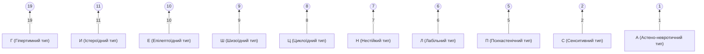

# Психологічний профіль (ПДО): Віталій (Тест)
> Дата: 14.04.2026 | Стать: Чол

---

## 📊 Графік акцентуацій характеру
Цей графік відображає інтенсивність прояву різних рис характеру. Чим вищий бал, тим яскравіше виражена ця особливість.

---

## 🔍 Детальна розшифровка шкал

### Основні типи:
- **Гіпертимний тип (Г)**: 19 балів — *Високий рівень вираженості.*
- **Істероїдний тип (И)**: 11 балів — *Високий рівень вираженості.*
- **Епілептоїдний тип (Е)**: 10 балів — *Високий рівень вираженості.*
- **Шизоїдний тип (Ш)**: 9 балів — *Високий рівень вираженості.*
- **Циклоїдний тип (Ц)**: 8 балів — *Високий рівень вираженості.*
- **Нестійкий тип (Н)**: 7 балів — *Високий рівень вираженості.*
- **Лабільний тип (Л)**: 6 балів — *Високий рівень вираженості.*
- **Психастенічний тип (П)**: 5 балів — *Середній рівень вираженості.*
- **Сенситивний тип (С)**: 2 балів — *Низький рівень вираженості.*
- **Астено-невротичний тип (А)**: 1 балів — *Низький рівень вираженості.*

### Додаткові показники:
- **Маскулінність (М)**: 8 балів
- **Депресивність (d)**: 7 балів
- **Делінквентність (Д)**: 3 балів
- **Вразливість (В)**: 1 балів

- **Індекс щирості (v)**: 2 (Норма: від -4 до +4)
- **Кількість помилок вибору**: 5

---

## 📌 Що це означає для вас?

Цей профіль не є вироком, це лише опис вашої «внутрішньої архітектури». Знання свого типу допомагає:
1. Розуміти причини конфліктів у парі.
2. Помітити, коли ви дієте за «автоматичним» сценарієм.
3. Використовувати свої сильні сторони, не руйнуючись об слабкі.

**Бажаєте розібрати цей звіт детальніше?**
Запишіться на 20-хвилинну безкоштовну консультацію, щоб зрозуміти, як ці результати впливають на ваш стан сьогодні.

[👉 Записатись на розбір](https://t.me/kobak_vit)
