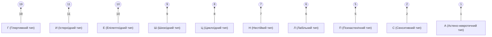

# Психологічний профіль (ПДО): Демо
> Дата: 18.04.2026 | Стать: Жін

---

## 📊 Графік акцентуацій характеру
Цей графік відображає інтенсивність прояву різних рис характеру. Чим вищий бал, тим яскравіше виражена ця особливість.

---

## 🔍 Детальна розшифровка шкал

### Основні типи:
#### **Гіпертимний тип (Г)**: 19 балів — *Високий рівень.*
> **Гіпертимний тип (H)**
> Постійно піднятий настрій, висока енергія та жага до лідерства. Ви — двигун будь-яких починань, але остерігайтеся нерозбірливості в контактах та ризикованих компаній.
> [Читати більше про цей тип](https://t.me/order_in_chaos/H)

#### **Істероїдний тип (И)**: 11 балів — *Високий рівень.*
> **Істероїдний тип (I)**
> Ненаситна жага уваги та захоплення. Ваше життя — це сцена. Використовуйте свій артистизм для творчості, а не для маніпуляцій.
> [Читати більше про цей тип](https://t.me/order_in_chaos/I)

#### **Епілептоїдний тип (Е)**: 10 балів — *Високий рівень.*
> **Епілептоїдний тип (E)**
> Схильність до дратівливості, агресії та прагнення до домінування. Ви любите порядок і дисципліну, але остерігайтеся злопам’ятності.
> [Читати більше про цей тип](https://t.me/order_in_chaos/E)

#### **Шизоїдний тип (Ш)**: 9 балів — *Високий рівень.*
> **Шизоїдний тип (Sh)**
> Замкнутість та багатий внутрішній світ. Вам важко встановлювати емоційні контакти, але ваші захоплення вирізняються глибиною та неординарністю.
> [Читати більше про цей тип](https://t.me/order_in_chaos/Sh)

#### **Циклоїдний тип (Ц)**: 8 балів — *Високий рівень.*
> **Циклоїдний тип (C)**
> Періодичні зміни фаз підйому та спаду (по 1-2 тижні). У фазі спаду — втрата енергії та апатія. Знання своєї циклічності — ключ до вашої продуктивності.
> [Читати більше про цей тип](https://t.me/order_in_chaos/C)

#### **Нестійкий тип (Н)**: 7 балів — *Високий рівень.*
> **Нестійкий тип (N)**
> Постійний потяг до розваг та неробства. Вам важко підкорятися дисципліні, але знаходження справжнього зацікавлення може дати вам опору.
> [Читати більше про цей тип](https://t.me/order_in_chaos/N)

#### **Лабільний тип (Л)**: 6 балів — *Високий рівень.*
> **Лабільний тип (L)**
> Екстремальна мінливість настрою через дрібниці. Ви дуже щирі та потребуєте емпатії. Ваш настрій завжди "на обличчі", і це ваша щирість.
> [Читати більше про цей тип](https://t.me/order_in_chaos/L)

#### **Психастенічний тип (П)**: 5 балів — *Середній рівень.*
#### **Сенситивний тип (С)**: 2 балів — *Низький рівень.*
#### **Астено-невротичний тип (А)**: 1 балів — *Низький рівень.*

### Додаткові показники:
- **Маскулінність (М)**: 8 балів
- **Депресивність (d)**: 7 балів
- **Делінквентність (Д)**: 3 балів
- **Вразливість (В)**: 1 балів

- **Індекс щирості (v)**: 2 (Норма: від -4 до +4)
- **Кількість помилок вибору**: 5

---

## 📌 Що це означає для вас?

Цей профіль не є вироком, це лише опис вашої «внутрішньої архітектури». Знання свого типу допомагає:
1. Розуміти причини конфліктів у парі.
2. Помітити, коли ви дієте за «автоматичним» сценарієм.
3. Використовувати свої сильні сторони, не руйнуючись об слабкі.

**Бажаєте розібрати цей звіт детальніше?**
Запишіться на 20-хвилинну безкоштовну консультацію, щоб зрозуміти, як ці результати впливають на ваш стан сьогодні.

[👉 Записатись на розбір](https://t.me/kobak_vit)
